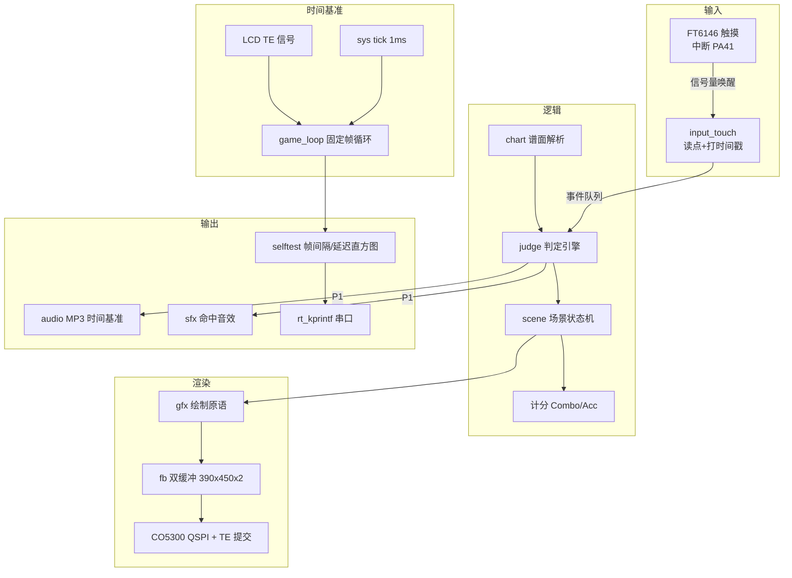

# 方案设计说明

| 项 | 内容 |
|---|---|
| 文档编号 | DOC-02 |
| 项目名称 | HSP 微音游（暂定） |
| 版本 / 状态 | v0.4 / 草稿 |
| 负责人 / 日期 | kuro-0721 / 2026-10-10 |

## 修订记录

| 版本 | 日期 | 修改人 | 修改内容 | AI参与 |
|---|---|---|---|---|
| v0.1 | 2026-10-10 | kuro-0721 | 创建：总体架构、模块划分、帧循环与判定设计、物理验证计划 | 是（agent 起草，学生确认架构方案） |
| v0.2 | 2026-10-10 | kuro-0721 | §7 决策表补入产品范围决策（技术验证原型，不做面向玩家的成品，见 `adr/0004`） | 是（学生拍板，agent 归纳备选并写入） |
| v0.3 | 2026-10-10 | kuro-0721 | 随 REQ-009 需求变更（CR-03）同步：`haptic` 模块改为 `sfx` + 软件混音、架构图与硬件分配更新、新增风险 R-09、验证计划改音效判据 | 是（学生决策，agent 同步影响面） |
| v0.4 | 2026-10-17 | kuro-0721 | M3 第 1 步实现对齐：`fb_swap()` → `fb_present()`（单缓冲，与 ADR-0003 一致）、补 `fb_flush_rect()` 脏区接口、`gfx_text()` 推迟到第 3 步 | 是（agent 实现时发现 §4.1 的「双缓冲」与 ADR-0003 冲突并修正） |

## 1. 设计输入

- 需求来源：`01-需求规格说明.md`（版本 v0.1，共 14 条）
- 硬件平台：黄山派 SF32LB525UC6，板型 `sf32lb52-lchspi-ulp`；SDK 版本 v2.5.1（课程统一）
- 关键约束：
  - 屏幕 1.85" 390×450，QSPI（CO5300），**TE/VSYNC 可用**；触摸 IC **FT6146**；背光 PWM（PWMT1 ch4）
  - 大核 SRAM 512KB、小核 64KB；PSRAM 8MB（OPI 144MHz）→ 帧缓冲放 PSRAM
  - 单帧 390×450×2B = **351KB**，双缓冲 **702KB**
  - 板载无 WiFi；本项目不联网
  - 不使用 LVGL（见 ADR-0001）；素材自制或免授权（见 ADR-0002）
  - 课程第 7-10 周仅 4 周可用于设计/实现/测试（见 `00` 的 C-04）

## 2. 总体架构

> 自绘方案：不引入 UI 框架，主循环自己做帧节拍，触摸事件带时间戳进入判定引擎。



## 3. 模块划分与需求追踪

| 模块 | 职责 | 对外接口 | 实现的需求 | 代码路径（计划） | 测试 |
|---|---|---|---|---|---|
| `fb` | **整屏缓冲（PSRAM 351KB）+ 每帧单次提交**（ADR-0003）；另提供整宽脏区提交接口备用 | `fb_init()` `fb_present()` `fb_backbuffer()` `fb_flush_rect()` `fb_clear()` | REQ-002、REQ-101、REQ-102 | `src/fb.c` | TC-002、TC-101、TC-102 |
| `gfx` | 绘制原语：填充矩形、横线、竖线。**点阵文字 `gfx_text()` 留到第 3 步**（结算页需要时才实现，先不引入字模表） | `gfx_fill_rect()` `gfx_hline()` `gfx_vline()` | REQ-002、REQ-004、REQ-005 | `src/gfx.c` | TC-002、TC-004 |
| `game_loop` | 固定帧循环、帧间隔统计、TE 同步 | `game_loop_run()` `loop_stats()` | REQ-002、REQ-101、REQ-104 | `src/game_loop.c` | TC-101、TC-104 |
| `input_touch` | 触摸中断处理、I2C 读点、事件队列（带时间戳） | `touch_init()` `touch_pop_event(&ev)` | REQ-003、REQ-104 | `src/input_touch.c` | TC-003、TC-104 |
| `judge` | 判定窗口判定、误触/重复点击处理、Combo 与 Acc 计算 | `judge_note(&note, t_ms)` `judge_stats()` | REQ-003、REQ-004 | `src/judge.c` | TC-003、TC-004 |
| `chart` | 文本谱面解析、音符池管理 | `chart_load_builtin()` `chart_next_note()` | REQ-006 | `src/chart.c` | TC-006 |
| `scene` | 状态机：主界面 → 演奏 → 结算 → 重开 | `scene_update(dt)` `scene_switch(id)` | REQ-001、REQ-005 | `src/scene.c` | TC-001、TC-005 |
| `selftest` | 启动自检：帧率统计、判定延迟直方图、谱面摘要，输出 PASS/FAIL | `selftest_run()` | REQ-007 | `src/selftest.c` | TC-007 |
| `audio`（P1） | TF 卡 MP3 播放、以音频进度为时间基准 | `audio_play()` `audio_pos_ms()` | REQ-008 | `src/audio.c` | TC-008 |
| `sfx`（P1） | 命中音效反馈（可开关）：音效 PCM 与曲目 PCM **软件混音**后送 I2S（见 ADR-0005） | `sfx_set_enabled()` `sfx_trigger()` | REQ-009 | `src/sfx.c` | TC-009 |
| `assets` | 素材与合规清单（曲目、美术） | — | REQ-105 | `docs/` 清单 + `src/assets/` | TC-105 |

> `src/SConscript` 会自动收集 `src/*.c`，新增模块直接放进去即可（**只有 `main.c` 定义 `main()`**）。

## 4. 接口设计

### 4.1 软件接口

| 接口 | 输入 | 输出 | 错误处理 | 说明 |
|---|---|---|---|---|
| `touch_pop_event(&ev)` | — | `0` 有事件 / `-1` 无 | 队列空返回 -1 | 事件含 `t_ms`（中断时刻的系统毫秒时间戳） |
| `judge_note(&note, t_ms)` | 音符、玩家点击时刻 | 判定结果枚举 | 无效音符返回 `JUDGE_NONE` | 判定窗口：Perfect ≤±60ms、Good ≤±120ms |
| `chart_parse(text, len)` | 谱面文本 | 音符数 / 负错误码 | 行格式错误返回行号负值 | 格式 `时间戳ms 轨号(0-3)`，`#` 起注释 |
| `loop_stats(&out)` | — | 帧数、平均/P95 帧间隔、超时帧数 | — | 供 selftest 与串口打印 |
| `fb_present()`（原 `fb_swap`） | — | — | — | **单缓冲**提交整屏并等 `tx_complete`（ADR-0003）；原「双缓冲交换」方案未采用 |
| `fb_flush_rect(x0,y0,x1,y1)` | 矩形坐标 | — | 越界自动裁剪；**非整宽区域退回整屏提交并只警告一次** | 预留的脏区提交接口，是否启用取决于 M3 音符密度压力测试结果 |

### 4.2 数据结构与状态机

```c
struct touch_ev { uint32_t t_ms; uint16_t x, y; };          /* 中断时刻打戳 */
struct note     { uint32_t hit_ms; uint8_t lane; uint8_t state; };
struct judge_stat { uint32_t perfect, good, miss; uint32_t combo, max_combo;
                    uint32_t score; uint32_t total; };
```

场景状态机（REQ-001/005）：

| 当前状态 | 事件 | 下一状态 | 动作 |
|---|---|---|---|
| TITLE（主界面） | 点击「开始」 | PLAYING | 解析谱面、重置判定统计、启动时间基准 |
| PLAYING | 最后一个音符判定完 | RESULT | 冻结统计、计算 Acc |
| PLAYING | （P0 不提供中途退出） | — | — |
| RESULT（结算） | 点击「重开」 | PLAYING | 重置统计并重跑同一谱面 |
| RESULT | 超时 30s 无操作 | TITLE | 回到主界面 |

## 5. 硬件资源分配

| 外设 | 用途 | 引脚/总线 | 参数 | 来源（原理图/例程） |
|---|---|---|---|---|
| LCD CO5300 | 390×450 显示 | QADSPI | 单屏；TE 可用 | `customer/boards/Kconfig_lcd`、`customer/peripherals/display/co5300/` |
| 触摸 FT6146 | 4 轨点按输入 | I2C + IRQ | `CONFIG_BSP_USING_TOUCHD=y`，TOUCH_IRQ_PIN=41 | `board.conf`、`customer/peripherals/touch_panel/` |
| 背光 | 亮度（可选调节） | PWMT1 ch4 | — | `Kconfig.board` |
| 按键 KEY1/KEY2 | 备用（P0 暂不用） | PA34 / PA43，高有效 | — | `board.conf` |
| RGB 灯 WS2812 | 调试指示 | PA32 | — | `proj.conf`、内置例程 |
| TF 卡（P1） | 曲目与谱面 | SPI1 + FAT | 卡需自备 | `example/multimedia/audio/mp3_sd_player` |
| 喇叭/功放（P1） | 音频播放 | AUD_CODEC + AW8155(PA42) | — | `board.conf` |
| 振动马达 | **本项目不使用**（ADR-0005：马达需外购焊接且未采购，REQ-009 已改为音效反馈） | 板载驱动 + 预留焊点（不焊接） | — | 立创黄山派硬件表 |

## 6. 软件运行设计

- **RT-Thread 线程/定时器规划**

| 线程/定时器 | 优先级 | 栈 | 周期 | 职责 |
|---|---|---|---|---|
| `main`（初始化） | 中 | 4KB | 一次性 | 板级初始化 → `selftest_run()` → 进入 TITLE |
| `game_loop` | 中 | 8KB | 固定帧（16ms 或 33ms） | 读输入 → 更新 → 绘制 → `fb_swap()` |
| `touch_in` | 高于 game_loop | 4KB | 中断驱动 | 等信号量 → I2C 读点 → 打时间戳入队 |
| 1ms 软件定时器 | — | — | 1ms | 提供统一的 `now_ms()` 时间基准 |

- **同步与通信**：触摸中断 → 信号量 → `touch_in` 线程 → 环形队列（单生产者单消费者）；主循环非阻塞 pop。
- **时序与实时性**：关键路径 = 触摸中断 → 事件入队 → 下一帧判定；要求 ≤ 1 帧 + 队列延迟。帧循环每帧记录 `now_ms()`，用于帧间隔统计。

## 7. 关键技术选型与决策

| 决策 | 备选方案 | 选择理由 | 决策人 | ADR |
|---|---|---|---|---|
| 产品范围：**技术验证原型**，不做面向玩家的成品 | A. 技术验证原型 / B. 面向玩家的口袋音游成品 / C. A + P1 音频+振动补“手感”证据 | 开发板尺寸与交互条件决定了不会有真人玩家长期在板上玩；项目价值在于回答“MCU 级硬件能不能做到可演示的下落+判定”，并为未来音游专用设备探路；时间也不支持做成品 | 学生拍板 | `adr/0004` |
| 自绘 framebuffer + 固定帧循环 | 全 LVGL / 混合 | 时序指标是交付物，必须自己可控且可打印 | agent建议+学生确认 | `adr/0001` |
| 渲染缓冲：**整屏单缓冲 + 每帧单次提交**（分行刷已被实测否决） | 分行刷（每帧 8 次提交）/ 整屏双缓冲 | 实测 VSYNC 是瓶颈：整屏 29ms、p95 31ms、0 超时帧；分行刷 132ms | 学生确认（agent 提供可证伪的对比实验） | `adr/0003` |
| 素材自制或明确免授权 | 直接使用 Phigros 素材 | 版权与课程学术诚信双风险 | agent建议+学生确认 | `adr/0002` |
| P0 单曲内置、P1 走 TF 卡 | P0 直接上 TF 卡 + MP3 | 先隔离"时序"与"音频同步"两个变量，坏了能单独定位 | 学生确认 | 见 `01` 分期说明 |
| 以音频播放进度作为时间基准（P1） | 自己用定时器计时 | 避免解码启动延迟与漂移导致音画错位 | agent建议+学生确认 | 待 P1 补 ADR |
| 命中反馈：**特殊音效**（无马达，REQ-009 变更 CR-03） | A. 等马达到货再焊接 / B. 音效替代 / C. 砍掉反馈 | 马达需外购并自行焊接，R-04 未到货；音效不依赖采购，且本项目要保留「打击反馈」这一维度 | 学生拍板（agent 梳理共存方案与客观判据） | `adr/0005` |

## 8. 非功能设计

- **性能（REQ-101）**：**采用整屏缓冲 + 每帧单次提交**（ADR-0003）。M2 实测：单帧 29ms（CPU 填充 8ms + 提交等待 21ms）、p95 31ms、超时帧 0；而分行刷（8 次提交）为 132ms。**已知余量不足 4ms**：CPU 填 175,500 像素要 8ms，后续必须只刷脏区或启用硬件 2D 加速（`BSP_USING_EPIC` 已使能）。刷帧与 TE 对齐防撕裂。
- **资源（REQ-102）**：帧缓冲 702KB 放 PSRAM；音符池固定上限（如 128 个）避免动态分配；打印 SRAM 静态占用并保留 ≥20% 余量。
- **可靠性（REQ-103）**：帧循环内不阻塞（I2C 读点在独立线程）；每 60s 打印 free heap；异常时 `rt_kprintf` 输出状态而非断言重启。
- **响应性（REQ-104）**：触摸中断即打时间戳，避免把 I2C 读点耗时算进判定误差；用 GPIO 打点 + 串口时间戳测量端到端延迟。
- **合规（REQ-105）**：所有音频/美术素材在 `docs/` 内附来源与许可说明；不含商业音游素材。

## 9. 风险与备选方案

| 风险 | 概率 | 影响 | 应对 / Plan B | 台账编号 |
|---|---|---|---|---|
| FT6146 读点延迟过大，判定窗口 ±60ms 做不到 —— **风险大幅降低** | 中→低 | 判定手感不可用 | 实测：触摸中断→读点 253 次 0ms、1 次 1ms（1ms 时间戳分辨率，准确表述为 **<1ms**），延迟不再是瓶颈；**仍需在谱面/判定引擎阶段验证判定容差（R-01 保留）** | R-01 |
| 全屏重绘导致帧率不足 30fps —— **已实测确认并解决** | 高 | 已由 ADR-0003 解决（分行刷 132ms → 整屏单次提交 29ms / p95 31ms / 0 超时帧）；**剩余余量不足 4ms** 是新的关注点 | 后续必须只刷脏区或启用 EPIC 硬件 2D 加速 | R-02 |
| P1 音画不同步（解码延迟/漂移） | 中高 | REQ-008 不通过 | 以音频进度为基准；必要时先用固定延时补偿，再考虑对齐节拍点 | R-03 |
| TF 卡、电池未采购（马达不再需要） | **高（当前均无）** | P1 无法开展 | 第 6 周内采购；P1 若延期则如实标注"未执行" | R-04 |
| 素材来源不合规或来不及制作 | 中 | REQ-105 不通过 | 只用自制/CC0；美术先用纯色几何图形占位 | R-05 |
| 第 7-10 周仅 4 周，P0 约 46h 工作量 | 高 | M3 延期 | 严格按 P0 范围冻结需求；M2 提前暴露性能问题 | R-06 |
| 软件混音（REQ-009）占 CPU，挤压帧循环余量（30fps 下仅约 4ms） | 中 | 中 | 混音放独立线程并降优先级；必要时缩短音效或退回抢占式（ADR-0005 子决策 a） | R-09 |

## 10. 物理验证计划

> 提前列出需要真机验证的节点，agent 到这些节点会暂停等待证据。

| 验证节点 | 验证内容 | 通过判据 | 对应需求 | 计划里程碑 |
|---|---|---|---|---|
| 屏幕点亮 | 显示测试图案，确认分辨率 390×450 与实物一致 | 图案满屏不偏移、无花屏 | REQ-002 | M2 |
| 触摸延迟 | 触摸中断 → 画面反馈的端到端延迟 | 实测值（目标 ≤50ms） | REQ-003、REQ-104 | M2 |
| 帧率与 TE | 帧间隔 P95 与撕裂情况 | P95 ≤33ms，无撕裂 | REQ-002、REQ-101 | M2 |
| 判定手感 | 人工按节拍点击 ≥50 次 | 判定分布合理，无系统性偏移 | REQ-003 | M3 |
| 一局完整流程 | 主界面 → 演奏 → 结算 → 重开 | 四项数据与串口日志一致 | REQ-001、REQ-005 | M3 |
| 音频同步（P1） | 画面落线时刻与音频节拍 | 偏差 ≤50ms | REQ-008 | M4 |
| 命中音效（P1） | 命中触发音效；关闭开关后无音效 | GPIO 打点 / 串口时间戳：音效触发与判定时刻偏差 ≤20ms | REQ-009 | M4 |

> **M2 已完成的验证（2026-10-10）**：① 屏幕点亮与分辨率确认（编译产物 `rtconfig.h` 为 390x450，屏上色带正常；**照片证据已补** `evidence/M2/color_bars_2026-10-10.jpg`，由学生录制的启动视频抽帧而得）；② 帧率对比实验（分行刷 132ms vs 整屏 29ms、p95 31ms、0 超时帧）；③ 触摸中断→读点 < 1ms（受 1ms 时间戳分辨率限制，不能声称精确值）。证据见 `evidence/M2/` 三个文件。
> **M2 尚未完成**：判定窗口的实际容差验证（需要谱面与判定引擎）、端到端延迟（需要 GPIO 打点）、音画同步。

## 11. 需求—设计追踪

| 需求ID | 设计章节/模块 | 说明 |
|---|---|---|
| REQ-001 | §3 `scene`、§4.2 状态机 | 主界面与开始流程 |
| REQ-002 | §3 `fb`/`gfx`/`game_loop`、§8 性能 | 4 轨下落渲染与帧率 |
| REQ-003 | §3 `input_touch`/`judge`、§4.1 | 触摸时间戳与三档判定 |
| REQ-004 | §3 `judge`/`gfx`、§4.2 数据结构 | Combo/分数/Acc |
| REQ-005 | §3 `scene`、§4.2 状态机 | 结算页与重开 |
| REQ-006 | §3 `chart`、§4.1 | 文本谱面解析 |
| REQ-007 | §3 `selftest`、§6 | 板上自检输出 |
| REQ-008 | §3 `audio`、§7（时间基准） | P1 音频与同步 |
| REQ-009 | §3 `sfx`、§5、§7（ADR-0005） | P1 命中音效反馈 |
| REQ-101 | §8 性能、§3 `fb`/`game_loop` | 帧率与防撕裂 |
| REQ-102 | §8 资源、§1 约束 | PSRAM 帧缓冲与内存余量 |
| REQ-103 | §8 可靠性、§6 线程 | 长时间运行与内存趋势 |
| REQ-104 | §3 `input_touch`、§8 响应性、§10 | 端到端延迟 |
| REQ-105 | §8 合规、§3 `assets` | 素材来源与许可 |
